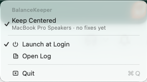

# BalanceKeeper

Small menu bar app for macOS that keeps the audio balance (left/right) always in the center.



Some app on my Mac kept moving the balance to the left and I never found which one. It was really annoying, so I made this. It stays in the menu bar doing nothing, and when something changes the balance it puts it back to the center.

## How it works

- Listens for balance changes on the default output device using CoreAudio. No polling, it only runs when the balance actually changes.
- When the output device changes (bluetooth headphone, HDMI, etc) it starts to listen the new one.
- Every correction goes to `~/Library/Logs/BalanceKeeper.log`, with the app in focus and the apps playing audio at that moment. macOS doesn't say who changed the balance, so this is only a hint to find the culprit.

## Requirements

- macOS 14.4 or newer
- Xcode Command Line Tools (`xcode-select --install`)

## Build and install

```sh
./scripts/build.sh
cp -R build/BalanceKeeper.app /Applications/
open /Applications/BalanceKeeper.app
```

A headphone icon will show up in the menu bar. Click on it and check "Launch at Login" if you want it to start with the Mac.

## Menu

- **Keep Centered**: turn it on/off. Below it shows the current output device and the time of the last fix
- **Launch at Login**: start with the Mac
- **Open Log**: open the log file
- **Quit**

A line in the log looks like this:

```
12/11/2026, 16:03:47  0.00 → 0.50  WH-1000XM5  focus: Discord  audio: Chromium Helper
```

If the fix happens up to 5 seconds after the output device changed, the line ends with `[right after output change]`. When you see this a lot, probably is the bluetooth reconnection and not some app.

## Testing

With the app running:

```sh
swift scripts/check.swift
```

It moves the balance all the way to the left and checks if it is back in the center after 1 second. If the app is not running (or is paused) the balance will stay on the left, so run it only with the app on.

Some outputs don't have balance at all (on my Mac the built-in speakers and HDMI don't), in this case the test fails right away with "device doesn't support balance" and the app just ignores that device.

## Project structure

```
Package.swift                  Swift package
Sources/BalanceKeeper/         app code
Resources/Info.plist           bundle info (menu bar only, no Dock icon)
scripts/build.sh               builds build/BalanceKeeper.app
scripts/check.swift            test described above
docs/                          screenshot for this readme
```

You can also open `Package.swift` in Xcode.

## Notes

- The build shows some deprecation warnings for `AudioHardwareService*`. These functions are deprecated since macOS 10.11 but they still work, and I didn't find other way to change the balance.
- The app is only ad-hoc signed. It's made for personal use, build it on your own machine.
